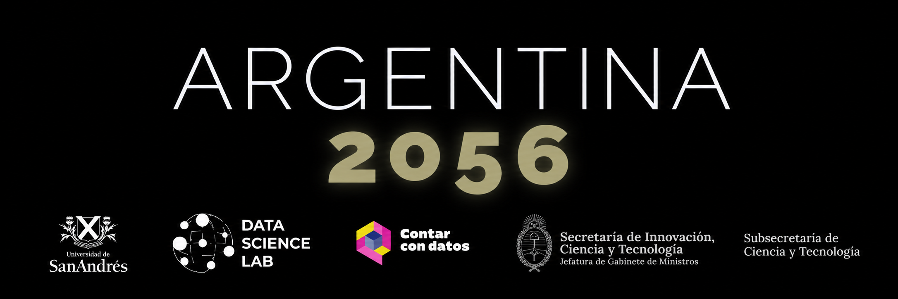
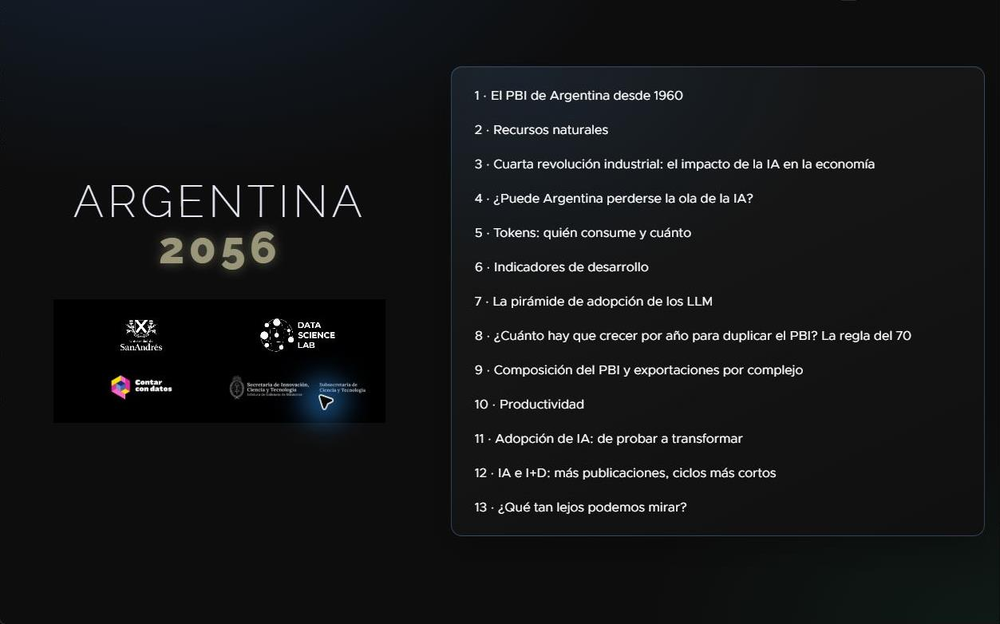
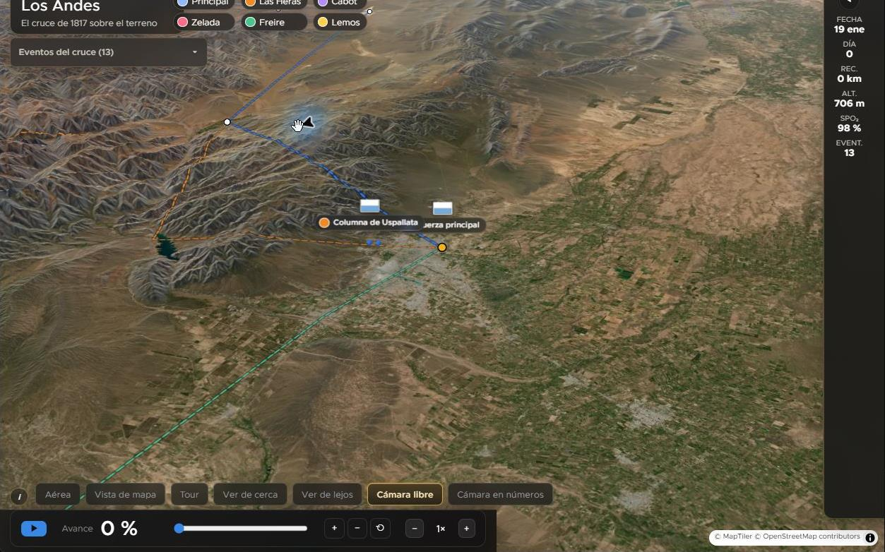
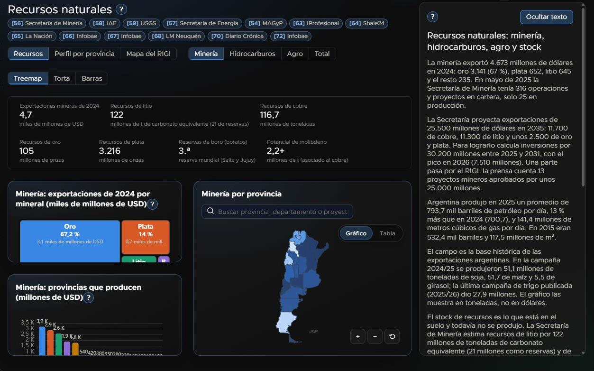
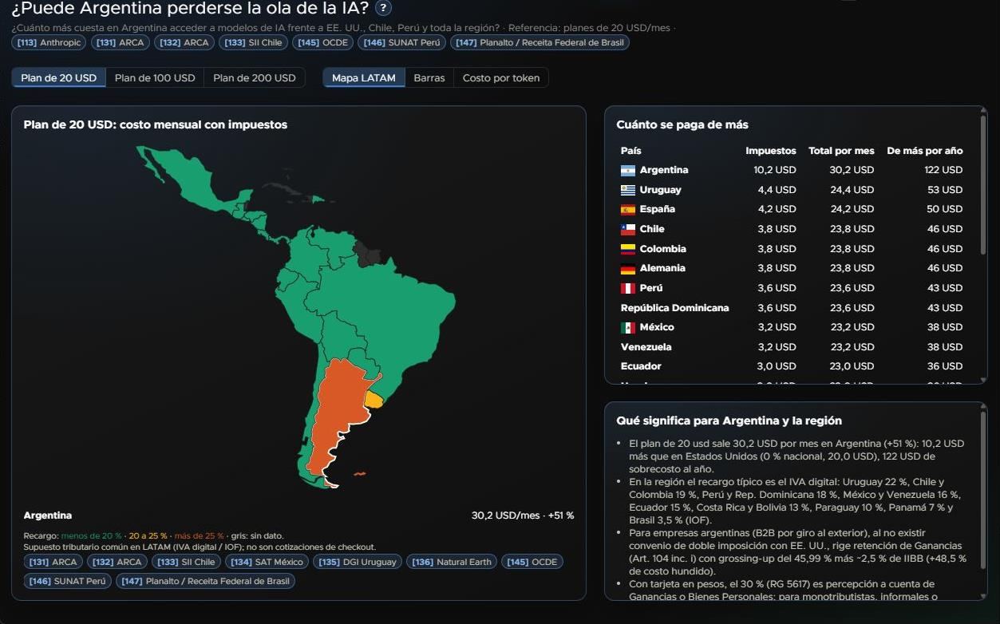
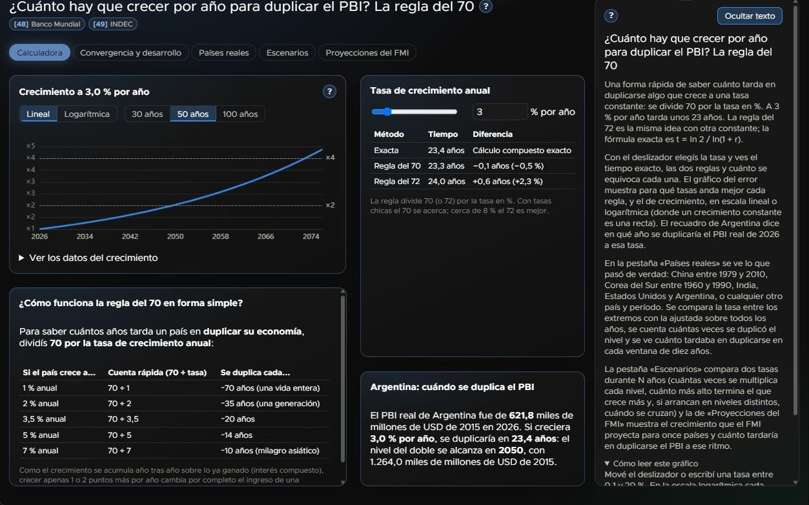
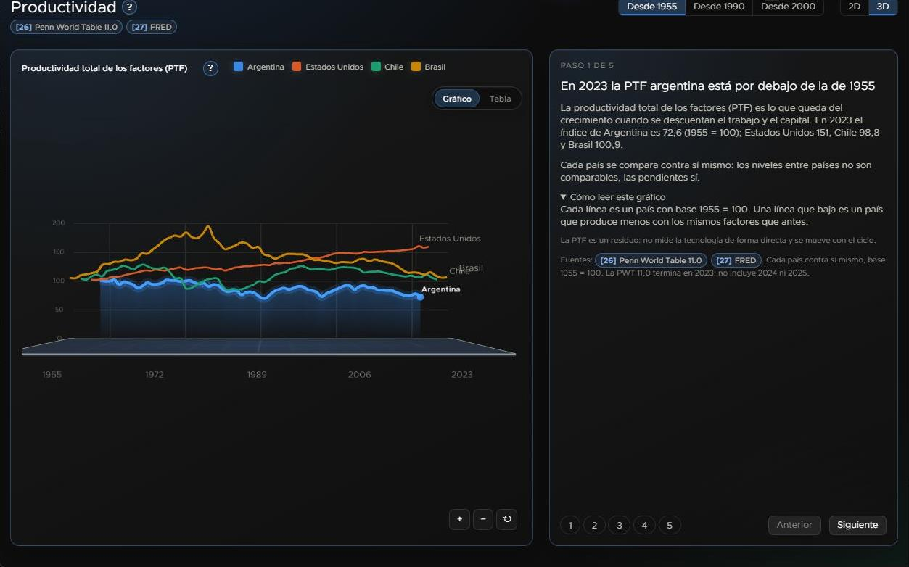

# Argentina 2056: From the Crossing of the Andes to the Fourth Industrial Revolution

[Leer en español](README.es.md)

Developed for the [Contar con Datos hackathon at Universidad de San Andrés](https://www.udesa.edu.ar/contar-con-datos).

An interactive data story connecting the Crossing of the Andes (1817) with Argentina's challenges through 2056: resources, the economy, population, and the impact of artificial intelligence and automation (the “Fourth Industrial Revolution” in Klaus Schwab's World Economic Forum framework).

- **The Andes**: a 3D map with real satellite imagery and terrain, showing miniature figures for the main Army of the Andes column, the other crossing columns, and their convergence.
- **Towards 2056** (formerly “Recorrido”): a guided presentation with an index and 17 slides, 2D and 3D charts, and a table for each chart. It includes a **productivity** slide (TFP and output per hour for Argentina, the US, Chile and Brazil, using Penn World Table data).
- **GDP simulator**: a large GDP chart through 2056 with adjustable factors on the right (baseline growth, AI, population, productivity and investment). It uses simple arithmetic on the selected assumptions.
- **Data**: a scrollable page with tables for each slide, a slide number and title selector for CSV downloads, individual table downloads, and reference links at the end, also downloadable as CSV.
- **Other organizations' projections**: IMF, OECD and UN data are loaded through the data pipeline (`data/processed/external_forecasts.json`, `scripts/fetch_external_forecasts.py`) and shown on slide 2 of the Data page.
- **Data Dashboard** (currently hidden): economy, resources, a 2056 forecast with an uncertainty fan, the AI revolution, and a simulator.

Uncertainty is shown as a percentile fan, disputed figures as ranges, and gaps as “no data.” Assumptions and data rules are documented in [`AGENTS.md`](AGENTS.md) and [`docs/assumptions.md`](docs/assumptions.md).

<a id="indice"></a>

## Contents

- [The journey in pictures](#el-recorrido-en-imagenes)
- [Army of the Andes 3D models (Meshy AI)](#modelos-3d-del-ejercito-de-los-andes-meshy-ai)
  - [Gen. José de San Martín](#modelo-3d-san-martin)
  - [Soldier in blue uniform (Grenadiers and Chasseurs)](#modelo-3d-soldado-azul)
  - [Soldier in red uniform (Battalions No. 7 and 8)](#modelo-3d-soldado-rojo)
  - [Flintlock musket with bayonet](#modelo-3d-fusil-de-chispa)
- [What it is](#que-es)
- [Methodology and data pipeline](#metodologia-y-pipeline-de-datos)
- [Stack](#stack)
- [The “Towards 2056” slides](#las-diapositivas-de-hacia-el-2056)
- [How to run it](#como-correrlo)
- [Structure](#estructura)
- [Institutions](#instituciones)
- [Author](#autor)
- [References](#referencias)
  - [Crossing of the Andes (1817)](#cruce-de-los-andes-1817)
  - [Map and terrain](#mapa-y-terreno)
  - [Conceptual framework](#marco-conceptual)
  - [Productivity (“Towards 2056” slide 5 and the simulator)](#productividad-diapositiva-5-de-hacia-el-2056-y-el-simulador)
  - [Economy, trade, resources and projections](#economia-comercio-recursos-y-proyecciones-recorrido-hacia-el-2056-y-data)
  - [Artificial intelligence and GDP](#inteligencia-artificial-y-el-pbi-diapositiva-6-de-hacia-el-2056-y-el-simulador)
  - [Human development, education, population and technology diffusion](#desarrollo-humano-educacion-poblacion-y-difusion-tecnologica-diapositivas-7-y-8-de-hacia-el-2056)
  - [Additional Data references](#referencias-complementarias-de-data)
  - [AI: access, adoption, tokens and R&D](#ia-acceso-adopcion-tokens-e-id-consulta-30-10-2026)

<a id="el-recorrido-en-imagenes"></a>

## [The journey in pictures](#indice)

Application screenshots from October 30, 2026. The [full gallery](docs/screenshots.md) includes the Andes journey and all “Towards 2056” slides.

| Cover and contents | Crossing of the Andes |
| --- | --- |
|  |  |
| Natural resources | Access to artificial intelligence |
|  |  |
| Compound growth | Productivity |
|  |  |

<a id="modelos-3d-del-ejercito-de-los-andes-meshy-ai"></a>

## [Army of the Andes 3D models (Meshy AI)](#indice)

The four `.glb` models depicting the Army of the Andes' uniforms and weapons were generated with **[Meshy AI](https://www.meshy.ai/)** and are available in the repository under `web/public/models/`.

> **3D model license (Free to Use):** All these models are **free to use** for educational, historical, personal or commercial projects, with **no attribution required**.

| 3D model | Unit / historical role | Repository `.glb` file | License |
| --- | --- | --- | --- |
| **Gen. José de San Martín** | General Staff — Commander in Chief of the Army of the Andes | [`web/public/models/san-martin.glb`](web/public/models/san-martin.glb) | Free to use · No attribution required (Meshy AI) |
| **Soldier in blue uniform** | Grenadiers and Chasseurs of the Andes (flintlock musket on the back) | [`web/public/models/soldier-blue.glb`](web/public/models/soldier-blue.glb) | Free to use · No attribution required (Meshy AI) |
| **Soldier in red uniform** | Line Infantry Battalions No. 7 and 8 — Pardos and Morenos (flintlock musket on the back) | [`web/public/models/soldier-red.glb`](web/public/models/soldier-red.glb) | Free to use · No attribution required (Meshy AI) |
| **Flintlock musket with bayonet** | Infantry weapon carried across the back during the mountain crossing | [`web/public/models/musket.glb`](web/public/models/musket.glb) | Free to use · No attribution required (Meshy AI) |

<a id="modelo-3d-san-martin"></a>

### [Gen. José de San Martín](#indice)

A dark blue coat with gold embroidery on collar and cuffs, a light blue sash across the chest, a bicorne with cockade, and a curved cavalry saber. Direct model link: [`web/public/models/san-martin.glb`](web/public/models/san-martin.glb) (*made with Meshy AI, free to use, no attribution required*).


<a id="modelo-3d-soldado-azul"></a>

### [Soldier in blue uniform (Grenadiers and Chasseurs)](#indice)

A dark blue coat with scarlet piping and cuffs, a tall shako with red plume, crossed white belts, and a flintlock musket mounted diagonally across the back (`mixamorig:Spine2`). Direct model link: [`web/public/models/soldier-blue.glb`](web/public/models/soldier-blue.glb) (*made with Meshy AI, free to use, no attribution required*).


<a id="modelo-3d-soldado-rojo"></a>

### [Soldier in red uniform (Battalions No. 7 and 8)](#indice)

A red wool jacket with dark lapels and white linen trousers of Line Infantry Battalions No. 7 and 8 (Pardos and Morenos), with the flintlock musket secured to the back during the ascent. Direct model link: [`web/public/models/soldier-red.glb`](web/public/models/soldier-red.glb) (*made with Meshy AI, free to use, no attribution required*).


<a id="modelo-3d-fusil-de-chispa"></a>

### [Flintlock musket with bayonet](#indice)

An infantry flintlock musket with fixed bayonet, mounted on the soldiers' backs in the “View uniforms” viewer, the opening march against the light blue sky, and the “Detailed models” mode of the Crossing of the Andes. Direct model link: [`web/public/models/musket.glb`](web/public/models/musket.glb) (*made with Meshy AI, free to use, no attribution required*).


<a id="que-es"></a>

## [What it is](#indice)

A **data science and visualization** project: it retrieves open data from official and international organizations through a reproducible pipeline (each file has a hash, source and date), validates it, and displays it in interactive 2D and 3D charts and maps. Each chart has a table, and each number in the presentation appears on the Data page with its reference.

<a id="metodologia-y-pipeline-de-datos"></a>

## [Methodology and data pipeline](#indice)

1. **Automated API pipelines:** Python scripts query official REST, SDMX and CKAN APIs for international and Argentine macroeconomic and sector series (World Bank, IMF, Energy Secretariat and Agriculture Secretariat). They clean and normalize units (for example, constant 2015 US dollars, equivalent barrels and tonnes) and export structured, versioned JSON files, including `worldGdp.json`, `energyArgentina.json`, `agroArgentina.json` and `imfWeo.json`.
2. **Extraction and normalization of official sources:** For publications without open APIs, such as INDEC national accounts, export-complex reports and productivity reports, or Mining Secretariat and USGS investment reports, data is extracted directly from primary documents, statistical tables and official reports. Automated tests validate internal consistency and component sums.
3. **Decoupled architecture and traceability:** The frontend consumes structured, versioned JSON and typed TypeScript modules. Records include explicit provenance metadata: issuing organization, link or publication identifier, retrieval date, period and unit.

<a id="stack"></a>

## [Stack](#indice)

| Layer | Technology |
|---|---|
| Web application | TypeScript (strict mode), React 19, Vite, Zustand |
| Visualization | ECharts (2D charts and maps), Three.js (3D views and Andes scene), MapLibre GL (satellite map with terrain), GSAP (animation) |
| Data and data science | Python 3.12 (standard library, `jsonschema`, NumPy). The `scripts/datapipe` pipeline records raw-file hashes, uses pure adapters, produces reproducible outputs and validates JSON schemas. Rule-of-70 statistical calculations (endpoint rate, regression of ln V against year with R² and residuals, rolling windows, exact doubling time) live in the pure TypeScript module `web/src/core/doubling.ts`. |
| Quality | pytest, Vitest, Playwright with axe (accessibility), ESLint, Ruff, bundle and data size budgets |
| Delivery | GitHub Actions (CI) and Vercel |

<a id="las-diapositivas-de-hacia-el-2056"></a>

## [The “Towards 2056” slides](#indice)

The presentation opens with a title and contents slide (slide 0), followed by six more:

1. Argentina's GDP since 1960 (global and regional rankings)
2. Natural resources (mining, oil and gas, agriculture and totals: treemap, pie or bars, producing provinces and map; a button shows production by province)
3. The rule of 70 (calculator, real countries, scenarios and IMF projections)
4. GDP composition and exports by complex (with a button to view exports by year and complex)
5. Productivity
6. Fourth Industrial Revolution: AI's economic impact (three scenarios through 2056, GDP per capita and population)

<a id="como-correrlo"></a>

## [How to run it](#indice)

```bash
cd web
npm ci
cp .env.example .env.local   # set VITE_MAPTILER_KEY (MapTiler satellite imagery and terrain)
npm run dev
```

Without `VITE_MAPTILER_KEY`, the Andes scene shows a notice and a plain background. The key is included in the bundle: restrict its allowed origins in MapTiler. Tests and validation run in CI, as required by [`AGENTS.md`](AGENTS.md).

<a id="estructura"></a>

## [Structure](#indice)

| Directory | Contents |
|---|---|
| `web/` | Application (Vite, React, TypeScript, MapLibre GL, Three.js, ECharts) |
| `model/` | Python cohort population module for the forecast model, with tests (design in `docs/model-design.md`) |
| `data/` | Raw files with hashes and sources, processed outputs and JSON schemas |
| `scripts/` | Data pipeline (`datapipe`), source downloads, checks and `precheck.py` |
| `docs/` | Decisions, assumptions, design and sources |

<a id="instituciones"></a>

## [Institutions](#indice)

Institutional links shown in the site footer:

- [Universidad de San Andrés](https://www.udesa.edu.ar)
- [Data Science Lab, Universidad de San Andrés](https://www.udesa.edu.ar/data-science-lab)
- [Contar con Datos](https://www.udesa.edu.ar/contar-con-datos)
- [Secretariat of Innovation, Science and Technology](https://www.argentina.gob.ar/jefatura/innovacion-ciencia-y-tecnologia)

<a id="autor"></a>

## [Author](#indice)

**Agustin Diaz-Cano, MS Candidate, Information Systems Engineering (UTN)**

[LinkedIn](https://www.linkedin.com/in/agustindiazcano) · [Portfolio](https://www.agustindiazcano.com/)

<a id="referencias"></a>

## [References](#indice)

The complete list, including which data comes from each source, is in [`docs/references.md`](docs/references.md).

<a id="cruce-de-los-andes-1817"></a>

### [Crossing of the Andes (1817)](#indice)

1. UNCuyo, *Virtual History of Mendoza*, “The Crossing of the Andes.” <http://historiavirtual.mza.uncu.edu.ar/mendoza-independiente/cruce.html>
2. Los Andes (Mendoza), article on the Crossing of the Andes, including San Martín's instructions to Las Heras of January 15, 1817. <https://www.losandes.com.ar/el-historico-cruce-de-1817-por-juan-marcelo-calabria>
3. Diario de Cuyo, “Chronicle of an Epic,” May 1, 2017. <https://www.diariodecuyo.com.ar/columnasdeopinion/Cronica-de-una-epopeya-20170501-0057.html>
4. Wikipedia, “San Martín's Routes.” <https://es.wikipedia.org/wiki/Rutas_sanmartinianas>
5. Wikipedia, “Battle of Chacabuco.” <https://es.wikipedia.org/wiki/Batalla_de_Chacabuco>
6. National Historical Museum, “The Crossing of the Andes.” <https://museohistoriconacional.cultura.gob.ar/noticia/el-cruce-de-la-cordillera-de-los-andes/>
7. El Arcón de la Historia, “The Crossing of the Andes (January 18 to February 8, 1817).” <https://elarcondelahistoria.com/el-cruce-de-la-cordillera-de-los-andes-18011817-al-08021817/>
8. General return of the Army of the Andes (Mendoza, December 31, 1816), in Espejo, *The Crossing of the Andes* (original to be verified).
9. Battle of Chacabuco plan coordinated by B. Mitre, in *History of San Martín*. <https://www.memoriachilena.gob.cl/602/w3-article-546948.html>
10. Municipality of Chacabuco, “Battle of Chacabuco” (order of battle). <https://chacabuco.gob.ar/wp-content/uploads/nuestraciudad/Batalla_Chacabuco.pdf>
11. Todo Argentina, “San Martín: Battle of Chacabuco.” <https://www.todo-argentina.net/biografias/san_martin/mili016.htm>
12. Foro Defensa Nacional, “The Crossing of the Andes.” <https://defensanacional.foroactivo.com/t4878-el-cruce-de-los-andes>
13. Diario El Tiempo, “General San Martín and Azul.” <https://www.diarioeltiempo.com.ar/nota-el-general-san-martin-y-el-azul-166860>
14. Wikipedia, “Crossing of the Andes.” <https://es.wikipedia.org/wiki/Cruce_de_los_Andes>
15. SENASA Resolution 258/2013 (Espinacito elevation). <https://www.argentina.gob.ar/normativa/nacional/norma-216719/texto>
16. El Bibliote, “Logistics of the Army of the Andes.” <https://elbibliote.com/resources/Temas/html/1468.php>
17. Felipe Pigna, “February 12, 1817: The Battle of Chacabuco,” El Historiador (including San Martín's dispatch). <https://elhistoriador.com.ar/12-de-febrero-de-1817-la-batalla-de-chacabuco/>
18. National Historical Museum, “The Battle of Chacabuco.” <https://museohistoriconacional.cultura.gob.ar/noticia/la-batalla-de-chacabuco/>
19. Chilean Academy of Military History, “Battle of Chacabuco.” <https://www.academiahistoriamilitar.cl/academia/batalla-de-chacabuco/>
20. Infobae, “Battle of Chacabuco: San Martín's urgency, O'Higgins's risky attack and the Grenadiers' lethal charge” (February 12, 2026). <https://www.infobae.com/historia/2026/02/12/batalla-de-chacabuco-la-urgencia-de-san-martin-el-arriesgado-ataque-de-ohiggins-y-la-carga-letal-de-los-granaderos>

The Chacabuco casualty figures differ among sources 5, 10, 17, 18, 19 and 20. The screen uses San Martín's dispatch and identifies the alternatives.

<a id="mapa-y-terreno"></a>

### [Map and terrain](#indice)

21. MapTiler: satellite imagery, Terrain-RGB v2 elevation model and geocoder. <https://www.maptiler.com>
22. © OpenStreetMap contributors (place names and locations). <https://www.openstreetmap.org/copyright>

<a id="marco-conceptual"></a>

### [Conceptual framework](#indice)

23. Schwab, K. (2016). *The Fourth Industrial Revolution*. World Economic Forum.

<a id="productividad-diapositiva-5-de-hacia-el-2056-y-el-simulador"></a>

### [Productivity (“Towards 2056” slide 5 and the simulator)](#indice)

24. INDEC, Working Paper No. 52, *Productivity and Capital Stock* (TFP and labor productivity, 2016–2025). <https://www.indec.gob.ar/ftp/cuadros/economia/productividad_stock_capital_10_26.pdf>
25. Baumann Fonay, I. (2026). “Argentina's TFP and Potential GDP, 1990–2025.” <https://macroargentina.substack.com/p/ptf-y-pib-potencial-de-argentina>, and its series on Alphacast <https://www.alphacast.io/datasets/potential-gross-domestic-product-output-gap-tfp-53419>
26. Penn World Table 11.0 (Groningen Growth and Development Centre), via FRED. <https://www.rug.nl/ggdc/productivity/pwt/> and <https://fred.stlouisfed.org/series/EMPENGARA148NRUG> (employment in Argentina)
27. Acemoglu, D. (2024). «The Simple Macroeconomics of AI». NBER Working Paper 32487. <https://www.nber.org/papers/w32487>

The two 2025 TFP estimates differ (INDEC +2.8%, Baumann +4.2%); PWT ends in 2023. Other sources in section 4.1 of [`docs/references.md`](docs/references.md), including AI literature, context and rejected sources, are listed there with their status.

<a id="economia-comercio-recursos-y-proyecciones-recorrido-hacia-el-2056-y-data"></a>

### [Economy, trade, resources and projections (“Towards 2056” and Data)](#indice)

Links to the data used by the application. The same list appears in its Data section and, with details for each figure, in [`docs/references.md`](docs/references.md).

**GDP, population and projections**

28. World Bank, WDI: real GDP in constant 2015 dollars (`NY.GDP.MKTP.KD`) and population, all countries, 1960–2025. <https://api.worldbank.org/v2/country/all/indicator/NY.GDP.MKTP.KD>
29. World Bank, WDI, Argentina (GDP, population, GDP per capita, exports, growth and capital formation). <https://api.worldbank.org/v2/country/ARG/indicator/>
30. INDEC, population estimates and projections 2022–2040 (2022 Census). <https://www.indec.gob.ar/ftp/cuadros/publicaciones/proyecciones_nacionales_2022_2040.pdf>
31. IMF, World Economic Outlook (September 30, 2026 update): real growth, investment and population. <https://www.imf.org/external/datamapper/NGDPD@WEO/ARG> and <https://www.imf.org/en/Publications/WEO>
32. OECD, Economic Outlook 117, long-term scenarios (Argentina's real and potential GDP and population through 2056). <https://sdmx.oecd.org/public/rest/dataflow/OECD.ECO.MAD/DSD_EO_LTB@DF_EO_LTB/1.0>
33. UN, World Population Prospects 2024. <https://population.un.org/wpp/downloads>
34. INDEC, economic activity advance report, second quarter 2026 (value added by sector). <https://www.indec.gob.ar/uploads/informesdeprensa/pib_09_26065D6A3612.pdf>

**Exports and services**

35. INDEC, export complexes, 2025. <https://www.indec.gob.ar/uploads/informesdeprensa/complejos_03_2686A1604947.pdf>
36. INDEC, Argentine merchandise trade, August 2026. <https://www.indec.gob.ar/uploads/informesdeprensa/ica_08_26E158B1D119.pdf>
37. CEI (Foreign Ministry), analysis of Argentina's trade in services, 2026, based on INDEC balance-of-payments data. <https://cvigo.cancilleria.gob.ar/userfiles/2026-06_analisis_del_comercio_de_servicios_de_la_argentina_2026.pdf>

**Mining**

38. Mining Secretariat, ARMINERA 2025 (project pipeline, exports, resources and reserves). <https://www.argentina.gob.ar/sites/default/files/mayo_2025_-_arminera.pdf>
39. Mining Secretariat, provincial origin of mining exports (monthly reports). <https://www.argentina.gob.ar/sites/default/files/2026.09_origen_provincial_de_las_exportaciones_mineras.pdf> (January–August 2026) and <https://www.argentina.gob.ar/sites/default/files/2026.01_origen_provincial_de_las_exportaciones_mineras.pdf> (full year 2025).
40. USGS, Mineral Commodity Summaries 2026 (lithium). <https://pubs.usgs.gov/periodicals/mcs2026/mcs2026-lithium.pdf>
41. First Quantum, Taca Taca NI 43-101 technical report (February 19, 2026). <https://www.first-quantum.com/wp-content/uploads/2026/02/NR-26-06-First-Quantum-Files-Taca-Taca-43-101-Technical-Report-FINAL.pdf>

**Oil, gas and agriculture**

42. Energy Secretariat, open data (production by province, series since 1950 and reserves as of December 31, 2025). <https://datos.energia.gob.ar>
43. IAE, Vaca Muerta: 2025 analysis. <https://www.iae.org.ar/wp-content/uploads/2026/03/Vaca-Muerta_analisis-2025_vmo_260330_155248.pdf>
44. MAGyP, annual soybean, maize, wheat and sunflower series (datos.gob.ar). <https://datos.gob.ar/dataset?q=siembra+cosecha+produccion+rendimiento>

**RIGI projects** (press reports, unverified; the official list is at <https://www.argentina.gob.ar/economia/rigi>; <https://rigi.ar> is a private, unofficial site)

45. Chequeado (October 2, 2026), 47 registered and 23 approved for US$49.7 billion, using Economy Ministry data. <https://chequeado.com/el-explicador/el-gobierno-anuncio-en-paris-2-nuevos-rigi-cuantos-proyectos-se-aprobaron-y-cuantos-dolares-ingresaron-hasta-ahora/>
46. iProfesional, mining RIGI: 13 projects and US$25.23 billion. <https://www.iprofesional.com/energia/465973-rigi-minero-suma-13-proyectos-y-25230-millones-de-dolares-de-inversion-en-argentina>
47. Shale24, RIGI map. <https://www.shale24.com/oil-gas/mapa-definitivo-rigi-proyectos-aprobaron-cuales-quedan-2026-n276>
48. La Nación, more than 20 approved projects. <https://www.lanacion.com.ar/economia/rigi-hay-mas-de-20-proyectos-aprobados-con-una-inversion-total-de-casi-us50000-millones-nid15082026/>
49. Infobae, two mining projects (May 14, 2026). <https://www.infobae.com/economia/2026/05/14/el-gobierno-aprobo-dos-nuevos-proyectos-mineros-bajo-el-rigi-por-usd-2130-millones/>
50. Infobae, two further mining projects (February 27, 2026). <https://www.infobae.com/economia/2026/02/27/el-gobierno-aprobo-otros-dos-proyectos-mineros-bajo-el-rigi-sumaran-usd-1140-millones-en-inversiones/>
51. LM Neuquén, Vaca Muerta Sur. <https://www.lmneuquen.com/neuquen/aprueban-el-rigi-vaca-muerta-sur-un-proyecto-clave-n1179960>
52. El Cronista, Southern Energy gas pipeline. <https://www.cronista.com/negocios/el-gobierno-aprueba-el-rigi-para-el-gasoducto-de-us-1300-millones-que-southern-energy-hara-para-exportar-gnl-de-vaca-muerta/>
53. Diario Crónica (2026-10-09), Los Toldos II Este, Tecpetrol. <https://www.diariocronica.com.ar/noticias/2026/10/09/171375-nacion-aprobo-un-nuevo-rigi-para-vaca-muerta-invertiran-mas-de-us6400-millones>
54. El Economista, Los Toldos II Este: US$6.432 billion, Resolution 1771/2026. <https://eleconomista.com.ar/energia/los-toldos-luz-verde-megaproyecto-petrolero-us6432-millones-n98753/amp>
55. LM Neuquén, mining projects under construction. <https://mase.lmneuquen.com/mineria/argentina-uno-uno-los-proyectos-mineros-que-ya-estan-construccion-n1246226>
56. Infobae (2026-05-16), LLL Oil, YPF. <https://www.infobae.com/economia/2026/05/16/lll-oil-como-es-el-megaproyecto-de-ypf-en-vaca-muerta-que-busca-generar-mas-de-usd-100000-millones-en-exportaciones/>
57. LM Neuquén, investment commitments in Vaca Muerta in 2026. <https://mase.lmneuquen.com/empresas/vaca-muerta-los-yacimientos-mayores-compromisos-inversiones-2026-n1242081>

<a id="inteligencia-artificial-y-el-pbi-diapositiva-6-de-hacia-el-2056-y-el-simulador"></a>

### [Artificial intelligence and GDP (“Towards 2056” slide 6 and the simulator)](#indice)

Argentine growth scenarios with AI and estimates by other analysts.

58. Anthropic / Korinek et al. (2026), US AI scenarios through 2030. <https://www.anthropic.com/features/econ-scenarios>
59. PwC (2025), *Value in Motion*: up to 15 percentage points of global GDP by 2035. <https://www.pwccn.com/en/press-room/press-releases/pr-290425.html>
60. Goldman Sachs, AI may start to boost US GDP in 2027. <https://www.goldmansachs.com/insights/articles/ai-may-start-to-boost-us-gdp-in-2027>
61. Oxford Economics, modeling AI's macroeconomic impact. <https://www.oxfordeconomics.com/resource/ai-macroeconomic-impact-modelling/>
62. Reuters (October 13, 2026), the IMF says AI investment supports global growth. <https://www.reuters.com/world/china/imf-says-ai-investment-propping-up-global-growth-war-debt-threaten-outlook-2026-10-13/>
63. WTO (2025), *World Trade Report*: global GDP +12–13% by 2040. <https://www.wto.org/english/blogs_e/data_blog_e/blog_dta_29sep25_e.htm>
64. CEPR, «Mind the gap: the global impact of AI». <https://cepr.org/voxeu/columns/global-impact-ai-mind-gap>
65. Acemoglu, D. (MIT), «A new look at the economics of AI». <https://mitsloan.mit.edu/ideas-made-to-matter/a-new-look-economics-ai>
66. Penn Wharton Budget Model, «How AI could lift productivity and GDP growth». <https://knowledge.wharton.upenn.edu/articles/how-ai-could-lift-productivity-and-gdp-growth/>
67. Forecasting Research Institute, economic effects of AI. <https://forecastingresearch.org/economic-effects-of-ai>

<a id="desarrollo-humano-educacion-poblacion-y-difusion-tecnologica-diapositivas-7-y-8-de-hacia-el-2056"></a>

### [Human development, education, population and technology diffusion (“Towards 2056” slides 7 and 8)](#indice)

68. UNDP, Human Development Report: Argentina's historical HDI series (1990–2023) and Latin American comparison. <https://hdr.undp.org/data-center/human-development-index>
69. OECD, PISA results (2012, 2018, 2022): average reading, mathematics and science scores for Argentina and the region. <https://www.oecd.org/pisa/>
70. Stanford Institute for Human-Centered Artificial Intelligence (HAI), *Artificial Intelligence Index Report 2024*: training costs, compute and inference efficiency. <https://aiindex.stanford.edu/report/>
71. INDEC, 2022 National Population, Household and Housing Census: final results by province (45,892,285 inhabitants). <https://www.indec.gob.ar/indec/web/Nivel4-Tema-2-41-165>
72. INDEC, provincial origin of exports (OPEX): 2023 and 2024 annual technical reports by province and main category. <https://www.indec.gob.ar/indec/web/Nivel4-Tema-3-2-40>


<a id="referencias-complementarias-de-data"></a>

### [Additional Data references](#indice)

Additional links from the Data section catalog (`web/src/datasets/references.ts`). Identifiers and verification statuses are preserved; inclusion does not imply a new check of the original sources.

**Crossing of the Andes**

- **H6** (read): UNCuyo, Virtual History of Mendoza, “The Crossing of the Andes.” <https://historiavirtual.mza.uncu.edu.ar/mendoza-independiente/cruce.html>
- **H8** (reported): General return of the Army of the Andes (December 31, 1816), in Espejo, The Crossing of the Andes. <https://archive.org/details/elpasodelosande00espegoog>

**Productivity**

- **P3** (cited): Baumann Fonay, TFP and potential GDP series on Alphacast (data requires login). <https://www.alphacast.io/datasets/potential-gross-domestic-product-output-gap-tfp-9670>
- **P4** (read): Baumann Fonay on X (productivity and TFP analysis). <https://x.com/ivanfbf/status/2050931628965278028>
- **P5** (read): Ministry of Finance (2018), Economic Growth, TFP and Potential GDP in Argentina, Working Paper No. 1. <https://www.argentina.gob.ar/sites/default/files/crecimiento-economico-ptf-y-pib-potencial-en-argentina_1.pdf>
- **P9** (read): Anthropic, Estimating productivity gains. <https://www.anthropic.com/research/estimating-productivity-gains>
- **P10c** (read): METR (2025), Measuring the Impact of Early-2025 AI on Experienced Open-Source Developer Productivity: 19% more time with AI (outdated according to METR). <https://metr.org/blog/2025-07-10-early-2025-ai-experienced-os-dev-study/>
- **P10d** (read): Becker, Rush, Barnes and Rein (2025), the same METR study on arXiv. <https://arxiv.org/abs/2507.09089>
- **P10a** (cited): METR (19% slower with AI), via InfoQ. <https://www.infoq.com/news/2025/07/ai-productivity>
- **P10b** (cited): METR, via eWeek. <https://www.eweek.com/news/news-ai-tools-slow-developer-productivity-study/>
- **P11a** (context): IDB/INTAL, AI in Latin America and the Caribbean. <https://www.iadb.org/es/noticias/inteligencia-artificial-trae-amplios-beneficios-america-latina-y-el-caribe-estudio-bid>
- **P11b** (context): FGV IBRE, Brazilian productivity in 2024. <https://blogdoibre.fgv.br/node/2057>
- **P11c** (context): BLS, US productivity. <https://www.bls.gov/news.release/prod2.nr0.htm>
- **P11d** (context): OECD, GDP per hour worked. <https://www.oecd.org/es/data/indicators/gdp-per-hour-worked.html>
- **P11e** (context): DBnomics, Penn World Table 10 mirror. <https://db.nomics.world/GGDC/penn10>
- **P11f** (context): ABC (Paraguay), regional productivity. <https://www.abc.com.py/economia/2026/07/31/la-productividad-regional-cayo-04-anual-la-ia-busca-revertir-la-tendencia/>
- **P12** (rejected): The Conference Board, TED summary tables (gave +6.8% for Brazil in 2024, contradicting FGV). <https://www.conference-board.org/pdf_free/TED-SummaryTables-Charts-sep2025.pdf>
- **P13a** (secondary): El Observador (Uruguay) on the INDEC paper. <https://www.elobservador.com.uy/argentina/economia-y-negocios/la-productividad-argentina-crecio-al-ritmo-mas-alto-1996-pero-cae-la-calidad-del-empleo-n6042872>
- **P13b** (secondary): Derecha Diario on the INDEC paper. <https://derechadiario.com.ar/economia/productividad-registro-en-2025-mayor-avance-en-20-anos-bajo-gobierno-milei>

**Social development**

- **W1** (read): World Bank, World Development Indicators (WDI): life expectancy at birth (SP.DYN.LE00.IN), infant mortality (SP.DYN.IMRT.IN), Gini index (SI.POV.GINI), secondary and tertiary enrollment (SE.SEC.ENRR, SE.TER.ENRR), expected years of schooling (SE.SCH.LIFE) and public education spending (SE.XPD.TOTL.GD.ZS). <https://data.worldbank.org/indicator/>

**Natural resources**

- **R15** (cited): Rosario Board of Trade, 2025 meat and dairy balance (Expoagro, January 5, 2026): estimated 2025 beef, poultry, pork and milk. <https://www.expoagro.com.ar/balance-carnico-y-lacteo-2025/>

**RIGI projects**

- **R14** (read): Economy Ministry and Production Coordination Secretariat, official RIGI register and resolutions published in the Official Gazette (Resolution 1771/2026 and related resolutions). <https://www.boletinoficial.gob.ar>

**Map**

- **M1** (used): MapTiler, satellite imagery. <https://www.maptiler.com/cloud/>
- **M2** (used): MapTiler, Terrain-RGB v2 elevation model. <https://docs.maptiler.com/cloud/api/tiles/>
- **M3** (used): MapTiler Geocoding. <https://docs.maptiler.com/cloud/api/geocoding/>
- **M6** (used): MapLibre GL JS. <https://maplibre.org>
- **M7** (used): Three.js. <https://threejs.org>

**Artificial intelligence**

- **A20** (cited): VAT RG 4240: what it is and how much is paid in 2026 (21% VAT on digital services from abroad). <https://nacho.com.ar/iva-netflix-cobraran-el-impuesto-a-los-usuarios-de-servicios-digitales/>
- **A21** (cited): Global66, taxes and 30% income-tax withholding (RG 5617) on dollar purchases and subscriptions, 2026. <https://www.global66.com/blog/como-afectan-los-impuestos-a-tus-gastos-digitales/>
- **A22** (cited): SentiSight, AI subscription prices in 2026 (ChatGPT, Claude, Gemini). <https://www.sentisight.ai/ai-price-comparison-gemini-chatgpt-claude-grok/>
- **D7** (read): Epoch AI, Compute Trends Across Three Eras of Machine Learning: training compute in FLOPs. <https://epoch.ai/blog/compute-trends-across-three-eras-of-machine-learning>

**Technology diffusion**

- **D6** (read): Comin & Hobijn / NBER & Our World in Data, CHAT dataset: historical mass-adoption lags (>50%). <https://ourworldindata.org/technology-adoption>

**Agriculture**

- **E12** (read): SAGyP (Agriculture, Livestock and Fisheries Secretariat), crop estimates by crop and province (2024/25 season, datos.gob.ar). <https://datos.magyp.gob.ar/dataset/estimaciones-agricolas>

**Provincial profile**

- **S1** (read): National Directorate of Provincial Affairs (DNAP) and Treasury Secretariat (Economy Ministry), geographic distribution of provincial gross product and gross value added. <https://www.argentina.gob.ar/economia/hacienda/asuntosprovinciales>
- **S2** (read): Labor, Employment and Social Security Secretariat (Ministry of Human Capital), OEDE / SIPA: registered private and public employment by province (2024–2025). <https://www.trabajo.gob.ar/estadisticas/oede/estadisticasprovinciales.asp>
- **S3** (read): INDEC, Permanent Household Survey (EPH), poverty and extreme-poverty rates by urban area (2024–2025). <https://www.indec.gob.ar/indec/web/Nivel4-Tema-4-46-152>
- **S4** (read): Economy Ministry, National Directorate of Provincial Affairs (DNAP), federal revenue sharing and automatic transfers to provinces. <https://www.argentina.gob.ar/economia/hacienda/asuntosprovinciales/transferencias-gobiernos-locales>
- **S6** (cited): UNDP Argentina, The Map of Human Development in Argentina (provincial HDI, 2021); values were taken from Wikipedia's reproduction of the table. <https://www.undp.org/es/argentina/publicaciones/el-mapa-del-desarrollo-humano-en-argentina>
- **S5** (read): National Security Ministry, National Criminal Information System (SNIC), rates of alleged offenses per 100,000 inhabitants by province. <https://www.argentina.gob.ar/seguridad/estadisticas-criminales>


<a id="ia-acceso-adopcion-tokens-e-id-consulta-30-10-2026"></a>

### [AI: access, adoption, tokens and R&D (accessed October 30, 2026)](#indice)

Slide 9 includes a Latin American map and token prices. Business adoption, token consumption, the adoption pyramid and R&D are added at the end. Definitions and limitations: [evidence record](docs/ai-evidence-2026-10-30.md).

- **AI55** (read): OpenAI, Research acceleration: The view inside OpenAI (September 6, 2026): survey and internal telemetry; self-reported evidence, not a causal trial. <https://openai.com/index/research-acceleration-view-inside-openai/>
- **AI30** (read): Anthropic, official Claude Pro, Max, Ultra and API prices (accessed October 30, 2026). <https://claude.com/pricing>
- **AI31** (read): OpenAI, official API prices: GPT-6.1 Sol, Standard pricing, short context. <https://developers.openai.com/api/docs/pricing>
- **AI32** (read): Google, Gemini API prices: Gemini 2.5 Pro, Standard, context up to 200,000 tokens. <https://ai.google.dev/gemini-api/docs/pricing>
- **AI33** (read): xAI / SpaceXSI, Grok 4.7: models and API prices. <https://docs.x.ai/developers/models>
- **AI34** (read): Cursor, Models & Pricing: costs depend on model, plan and usage. <https://cursor.com/docs/models-and-pricing>
- **AI35** (read): Gallup, Frequent Use of AI in the Workplace Continued to Rise in Q4 (January 25, 2026; US fieldwork in Q4 2025). <https://www.gallup.com/workplace/701195/frequent-workplace-continued-rise.aspx>
- **AI36** (read): Yu et al., MIT FutureTech / CMU, AI Adoption in S&P 500 Firms (2026): enterprise integration in 2025; preprint. <https://arxiv.org/abs/2607.08920>
- **AI37** (read): Yotzov et al., Firms predict an AI productivity boom is coming, VoxEU/CEPR (2026), authors of Firm Data on AI, NBER 34836. <https://cepr.org/voxeu/columns/firms-predict-ai-productivity-boom-coming>
- **AI38** (read): OpenAI, Scaling AI for everyone (February 27, 2026): over 900 million weekly users and 50 million consumer subscribers. <https://openai.com/index/scaling-ai-for-everyone/>
- **AI39** (read): UN, World Population Prospects 2024, Summary of Results: world population of 8.2 billion in 2024. <https://www.un.org/development/desa/pd/sites/www.un.org.development.desa.pd/files/wpp2024_summary_of_results_final_web.pdf>
- **AI40** (read): Anthropic Economic Index, Cadences (June 26, 2026): tokens per conversation and artifact; normalized percentiles, not monthly users. <https://www.anthropic.com/research/economic-index-june-2026-report>
- **AI41** (read): Google, Alphabet investor presentation (June 2026): 3.2 × 10^15 tokens monthly across its products and APIs. <https://blog.google/alphabet/investor-presentation-june-2026/>
- **AI42** (read): OpenAI, The next phase of enterprise AI (April 8, 2026): more than 15 billion API tokens per minute. <https://openai.com/index/next-phase-of-enterprise-ai/>
- **AI43** (read): OpenRouter, State of AI 2025: more than 100 trillion (10^14) platform tokens; sample not representative of the entire market. <https://openrouter.ai/state-of-ai>
- **AI44** (read): arXiv, Monthly Submissions: official monthly counts of new submissions; CSV accessed October 30, 2026. <https://arxiv.org/stats/monthly_submissions>
- **AI45** (read): Preprints.org, Annual Report 2025, page 3: 31,691 preprints published in 2025. <https://www.preprints.org/frontend/home/report/2025-annual-report>
- **AI46** (read): SocArXiv, 2025 report (2026): 3,162 accepted papers; not equivalent to total submissions. <https://socopen.org/2026/>
- **AI47** (read): Google Research, Accelerating scientific breakthroughs with an AI co-scientist (2025): hypothesis and prior experimental validation. <https://research.google/blog/accelerating-scientific-breakthroughs-with-an-ai-co-scientist/>
- **AI48** (read): ARCA, foreign-currency transaction withholding: 30% rate depending on transaction and payment method. <https://www.afip.gob.ar/regimen-devolucion-percepciones/percepcion/importe.asp>
- **AI49** (read): ARCA, digital services: VAT on services consumed in Argentina and supplied from abroad. <https://www.afip.gob.ar/iva/servicios-digitales/obligados.asp>
- **AI50** (read): SII Chile, Circular 42/2020, VAT on digital services supplied from abroad. <https://www.sii.cl/normativa_legislacion/circulares/2020/circu42.pdf>
- **AI51** (read): SAT Mexico, guide to digital services VAT returns: 16% rate. <https://sat.gob.mx/cs/Satellite?blobcol=urldata&blobkey=id&blobtable=MungoBlobs&blobwhere=1461175010301&ssbinary=true>
- **AI52** (read): DGI Uruguay, goods and services taxed at the 22% standard rate. <https://www.gub.uy/direccion-general-impositiva/comunicacion/publicaciones/son-bienes-servicios-gravados-tasa-basica-del-22>
- **AI53** (used): Natural Earth, Admin 0 Countries 1:110m, public domain; illustrative Latin American geography. <https://www.naturalearthdata.com/downloads/110m-cultural-vectors/110m-admin-0-countries/>
- **AI54** (context): Global AI Adoption Visualization, AI Bear: visual reference for the viral infographic; figures replaced by primary sources without adding users across platforms. <https://www.ai-bear.io/p/are-you-among-16-of-free-ai-users>
- **AI56** (read): Jellyfish, 2026 Software Engineering Metrics Report: monthly token consumption distribution per engineer (median 51 million, P90 380 million, P99 1.35 billion). <https://jellyfish.co/library/state-of-engineering-management/>
- **AI57** (read): Anthropic, Claude Code — Manage costs effectively and Prompt caching: code and context are resent each turn; cache reads reduce dollar costs by up to 90% but count toward processed token volume. <https://docs.anthropic.com/en/docs/claude-code/costs>
- **AI58** (context): CCgather, Claude Code Leaderboard: community record of heavy agentic coding users (1 billion to over 15 billion tokens monthly). <https://ccgather.com>
- **AI59** (read): Briggs, J. and Kodnani, D. (2023), Goldman Sachs Global Investment Research, The Potentially Large Effects of Artificial Intelligence on Economic Growth: +7% of global GDP (~US$7 trillion) and +1.5 annual percentage points of productivity in developed economies over a decade. <https://www.gspublishing.com/content/research/en/reports/2023/03/27/d64e052b-0f6e-45d7-967b-d7be35fabd16.html>
- **AI60** (read): Cerutti, E. et al. (2025), IMF Working Paper WP/25/76, AI Adoption and Inequality: Mind the Gap: structural gap in TFP gains between advanced (+0.8 to +1.3% cumulative over 10 years) and emerging economies (+0.1 to +0.4%). <https://www.imf.org/en/Publications/WP/Issues/2025/04/11/AI-Adoption-and-Inequality-Mind-the-Gap-566125>
- **AI61** (read): Cazzaniga, M. et al. (2024), IMF Staff Discussion Note SDN/2024/001 and AI Preparedness Index (AIPI): AI readiness (0.68 in advanced economies versus 0.46–0.48 in Argentina and Latin America). <https://www.imf.org/en/Blogs/Articles/2024/06/17/mapping-the-worlds-readiness-for-artificial-intelligence-shows-prospects-diverge>
- **AI62** (read): Anthropic (2025), Anthropic Economic Index: Geography and Enterprise Usage (arXiv:2511.15080): income–AI usage elasticity (~0.7% more use per capita for each 1% higher GDP per capita) and bias toward high-income countries. <https://arxiv.org/abs/2511.15080>
- **AI63** (read): OECD, CIAT and IDB (2021–2025), VAT Digital Toolkit for Latin America and the Caribbean: VAT rates on cross-border digital services in Latin America and the Caribbean. <https://www.oecd.org/en/publications/vat-digital-toolkit-for-latin-america-and-the-caribbean_ff3da3bd-en.html>
- **AI64** (read): SUNAT Peru, Legislative Decree No. 1623 (effective December 2024): 18% IGV on digital services supplied by nonresident providers. <https://orientacion.sunat.gob.pe/servicios-digitales>
- **AI65** (read): Receita Federal do Brasil, Decree No. 12.499/2025: unified 3.5% IOF on international foreign-currency card purchases and subscriptions. <https://www.planalto.gov.br/ccivil_03/_ato2023-2026/2025/decreto/d12499.htm>
- **AI66** (read): Microsoft AI Economy Institute (2026), Global AI Diffusion Report: ~18.8% of the world's working-age population uses generative AI tools (ChatGPT, Gemini, Copilot, Claude, Meta AI, DeepSeek); 28.8% in the Global North versus 16.2% in the Global South. <https://www.microsoft.com/en-us/research/group/ai-economy-institute/>
- **AI67** (read): Menlo Ventures (2025), 2025: The State of Generative AI in the Enterprise: enterprise language-model share led by Anthropic Claude (~40%), OpenAI (~27%) and Google Gemini (~21%). <https://menlovc.com/perspective/2025-the-state-of-generative-ai-in-the-enterprise/>
- **AI68** (read): Jellyfish (2026), The State of AI in Software Engineering: telemetry from thousands of enterprise engineers (Claude Code, Cursor, GitHub Copilot); median ~US$81/month (51 million tokens), top quintile ~2.5 billion tokens/month and P99 spend ~US$2,452/month. <https://jellyfish.co/state-of-ai-software-engineering/>
- **AI69** (read): WorkOS / Nicholas Arcolano, Head of AI Research at Jellyfish (2026), Token Maxing and Diminishing Returns: the top 2% of engineers consume ~500 million tokens per week (~2–2.2 billion/month) in multi-agent workflows. <https://workos.com/blog/nicholas-arcolano-jellyfish-token-maxing-diminishing-returns>
- **AI70** (read): VibeCafé (April 2026), Token Consumption Percentiles: empirical P95–P99 distribution from 63.4 million to 247 million tokens/day (~1.9–7.4 billion/month) and Claude Code P99 of ~160 million tokens/day (~4.8 billion/month). <https://vibecafe.ai/blogs/token-consumption-percentiles>
- **AI71** (read): Cursor Insights (2026), The Asymmetry of Token Consumption: the top 10% of users account for nearly two thirds of all tokens consumed. <https://cursor.com/insights/the-asymmetry-of-token-consumption>
- **AI72** (read): Epoch AI (2026), OpenAI Coding Agent Spending: analysis of OpenAI researchers' internal coding-agent usage (median >US$600/day and P90 >US$7,000/day API). <https://epoch.ai/data-insights/openai-coding-agent-spending>
- **AI73** (read): Jellyfish (2026), Tokenomics for Your 2027 R&D Budget and Is Tokenmaxxing Cost-Effective?: analysis of enterprise quintiles and R&D budgets for AI-assisted engineering. <https://jellyfish.co/blog/tokenomics-2027-rd-budget/>
- **AI74** (read): The Pragmatic Engineer (Gergely Orosz, 2026), The Pulse: Interesting AI Coding Stats: summary of token consumption telemetry and adoption in engineering teams. <https://newsletter.pragmaticengineer.com/p/the-pulse-interesting-ai-coding-stats>

> Locations are approximate, dates between documented events are marked estimates, and troop figures vary by source. These limitations are recorded in [`docs/references.md`](docs/references.md).


