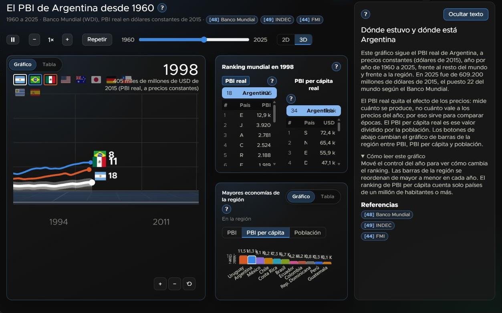
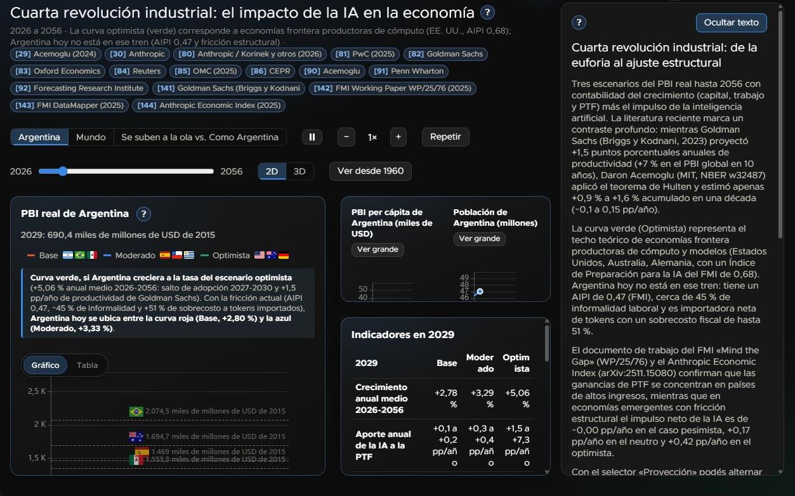
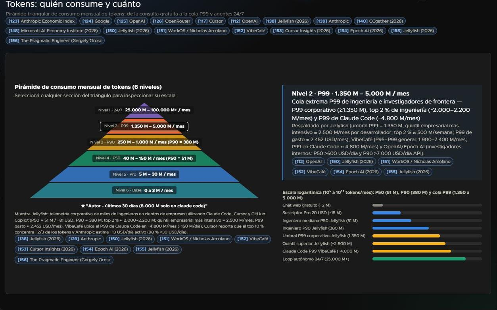
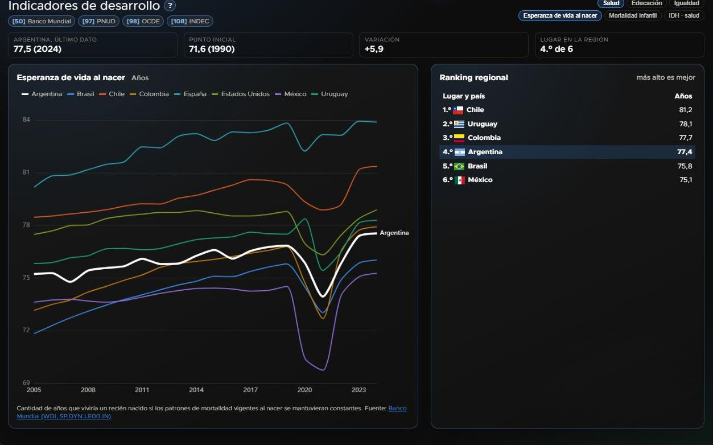
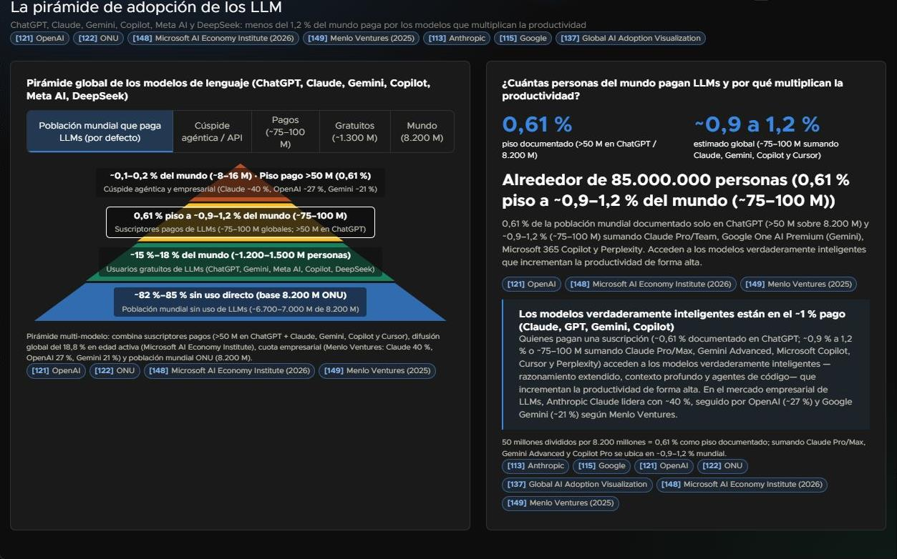
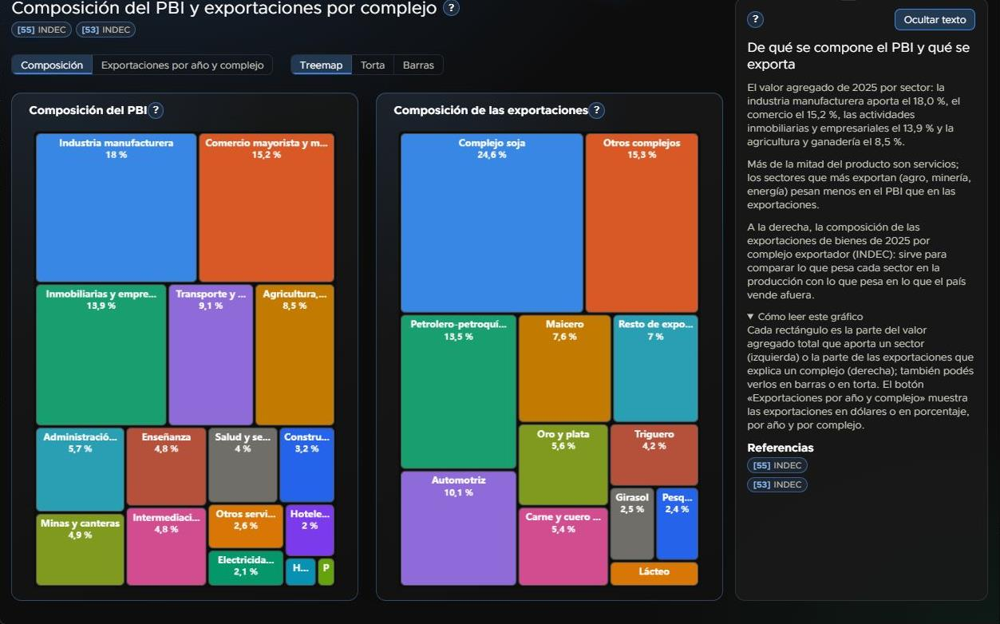
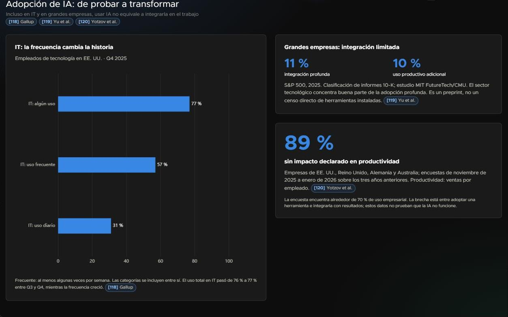
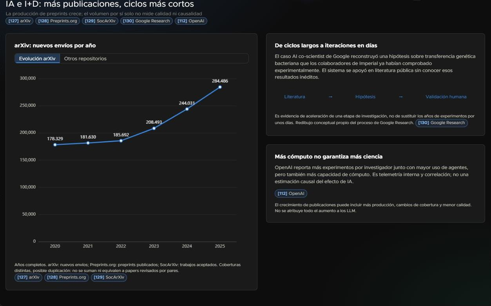
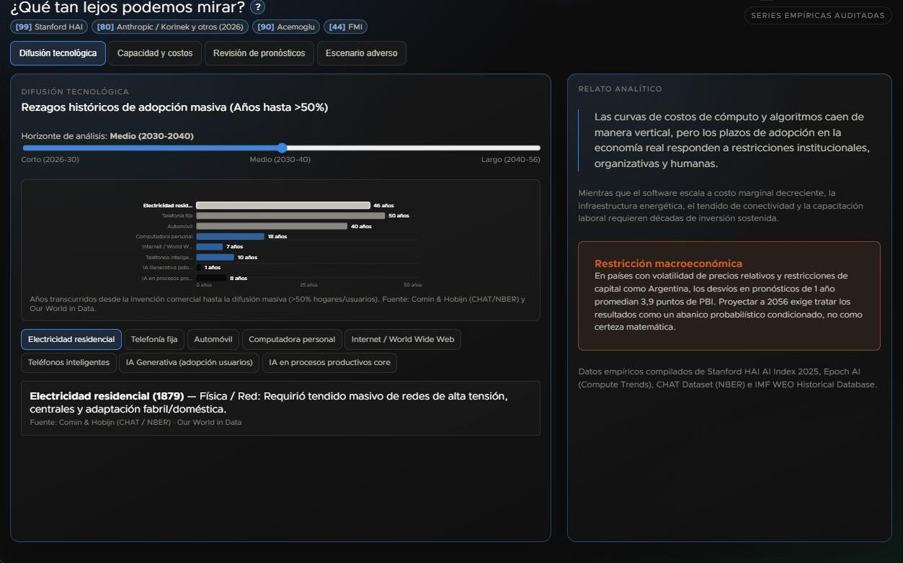
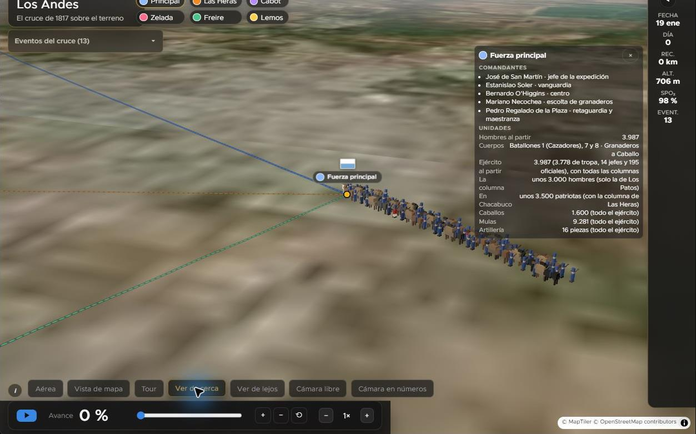

# Galería del recorrido

Capturas de la aplicación del 30 de octubre de 2026, tomadas en el navegador. El encuadre muestra el contenido de cada vista, sin las barras del navegador. Son vistas puntuales de los gráficos y controles interactivos.

## 00 indice

## 01 pbi

## 02 recursos

## 03 impacto ia

## 04 acceso ia

## 05 tokens

## 06 desarrollo

## 07 adopcion llm

## 08 regla 70

## 09 composicion

## 10 productividad

## 11 adopcion ia

## 12 investigacion

## 13 incertidumbre

## andes ejercito

## andes recorrido

