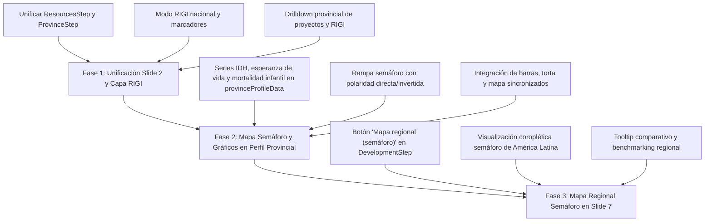

# Plan de Acción y Especificación: RIGI, Unificación de Recursos y Mapas Semáforo (Diapositivas 2 y 7)

## 1. Diagnóstico y Respuestas a los Puntos del Revisor

### 1.1. Unificación en Diapositiva 2: "Producción por provincia" vs. "Recursos"
- **Diagnóstico:** Efectivamente, en la Diapositiva 2 (`ResourcesStep.tsx`) existían tres sub-vistas bajo el selector "Mostrar": `Recursos`, `Producción por provincia` (que integraba el componente heredado `ProvinceStep.tsx`) y `Perfil por provincia` (`ProvinceProfileStep.tsx`). Tanto `Recursos` como `Producción por provincia` presentaban los mismos datos de producción minera, hidrocarburífera y agropecuaria por provincia, duplicando información y desorientando al usuario.
- **Solución:**
  1. **Unificar en una sola vista principal:** Eliminar la pestaña redundante `Producción por provincia`.
  2. La vista inicial y prioritaria será **Recursos y RIGI**, que ya cuenta con los totales nacionales, treemap/torta/barras por sector/mineral, mapa interactivo y desglose departamental.
  3. El selector de nivel superior queda simplificado en 2 vistas nítidas y complementarias:
     - **Recursos y RIGI** (vista productiva, proyectos estratégicos e inversiones).
     - **Perfil provincial** (ficha socioeconómica, IDH, salud, educación y coparticipación).

---

### 1.2. Interacción RIGI en el Mapa Nacional y Drilldown Provincial
- **Requerimiento:** Al activar "RIGI", mostrar en el mapa de Argentina dónde se ubican los proyectos RIGI en cada provincia. Al hacer click en una provincia, visualizar en qué departamentos/localizaciones están tanto los proyectos de recursos naturales habituales como los proyectos RIGI.
- **Solución:**
  1. **Botón / Modo RIGI:** Agregar un toggle o píldora destacada "RIGI" en la cabecera de la vista de Recursos.
  2. **Vista Nacional RIGI:**
     - El mapa de Argentina colorea las provincias receptoras según el volumen de inversión comprometida o número de proyectos aprobados/en evaluación (usando la base auditada de `rigiProjects.ts`: San Juan, Salta, Catamarca, Jujuy, Mendoza, Río Negro, Neuquén, Santa Cruz, etc.).
     - Dibuja marcadores (scatter pins) sobre los nodos provinciales con tooltips que detallan el monto de inversión ($ M USD), empresa y sector.
  3. **Drilldown Provincial:**
     - Al cliquear una provincia, el mapa hace zoom suave (usando `mapDrillTransition`) a nivel departamento.
     - Representa los puntos geográficos de los proyectos de recursos naturales existentes (cobre, litio, oro, hidrocarburos) y resalta con badge distintivo los proyectos bajo el régimen RIGI (ej. *Vicuña*, *Alumbrera-Agua Rica*, *Rincón*, *Los Azules*, *Vaca Muerta Sur*).
     - En el panel lateral / inferior se presenta la ficha técnica ampliada del proyecto seleccionado (inversión, resolución oficial, estado, referencias normativas).

---

### 1.3. Mapa Semáforo e Indicadores en Perfil Provincial (Diapositiva 2)
- **Requerimiento:** Mapa de Argentina por provincia con gama de colores semáforo para PBI, PBI per cápita, población, IDH, mortalidad infantil, esperanza de vida, etc. Dinámica similar con barras comparativas y gráfico de torta en la sección de perfil provincial.
- **Solución:**
  1. **Ampliación de Indicadores en `provinceProfileData.ts`:**
     - Incorporar series oficiales auditadas para las 24 provincias:
       - **PBI provincial (PBG)** y **PBI per cápita** (DNAP / INDEC).
       - **Población** (Censo 2022 INDEC).
       - **IDH provincial** (PNUD Argentina / INDEC).
       - **Esperanza de vida al nacer** (DEIS / Ministerio de Salud).
       - **Tasa de mortalidad infantil** (DEIS / Ministerio de Salud).
       - **Pobreza e indigencia** (EPH / INDEC).
       - **Coparticipación federal efectiva** (Ministerio de Economía).
       - **Tasa de criminalidad / seguridad** (SNIC / Ministerio de Seguridad).
  2. **Escala Semáforo (Traffic-Light Choropleth):**
     - Rampa cromática definida mediante variables semánticas (`--state-good`, `--state-warning`, `--state-critical` o rampa semáforo estandarizada en `tokens.css` y `tokens.ts`), garantizando estricto cumplimiento de la regla de no usar literales `#hex` en TSX/CSS.
     - **Polaridad configurable según indicador:**
       - *Indicadores positivos* (mayor es mejor: PBI pc, IDH, Esperanza de vida, Empleo registrado): Verde = valores altos, Amarillo = intermedios, Rojo = valores bajos.
       - *Indicadores negativos* (menor es mejor: Mortalidad infantil, Pobreza, Desempleo, Delitos): Verde = valores bajos, Amarillo = intermedios, Rojo = valores altos.
  3. **Componentes visuales sincronizados:**
     - **Mapa de Argentina:** Coloreado semáforo por provincia con zoom y selección.
     - **Gráfico de Barras comparativo:** Ranking horizontal de las 24 jurisdicciones con la barra de la provincia seleccionada destacada y la línea de promedio nacional.
     - **Gráfico de Torta / Donut:** Participación porcentual de la provincia en el total nacional (para PBI, población, exportaciones) o distribución por categorías/cuartiles.
     - **Ficha KPI:** Métricas detalladas del distrito al interactuar con cualquiera de las visualizaciones.

---

### 1.4. Botón de Comparación Regional con Mapa Semáforo en Diapositiva 7
- **Requerimiento:** En la Diapositiva 7 (`DevelopmentStep.tsx`, Indicadores de desarrollo humano y social), incorporar un botón para comparar los indicadores frente a los países de la región (América Latina) en un mapa con escala semáforo.
- **Solución:**
  1. En el selector de modos de `DevelopmentStep.tsx`, sumar la opción:
     - `Serie temporal` | `Comparación regional (barras)` | `Mapa regional (semáforo)`.
  2. Al seleccionar `Mapa regional (semáforo)`:
     - Renderizar un mapa coroplético de América Latina / Cono Sur donde cada país (Argentina, Chile, Uruguay, Brasil, México, Colombia, Perú, etc.) se colorea con la escala semáforo según su desempeño relativo en el indicador activo (Esperanza de vida, Mortalidad infantil, Resultados PISA, IDH, Gini, Pobreza).
     - Argentina resaltada con borde distintivo y tooltip que compara su valor frente al promedio regional.

---

## 2. Fases de Implementación y Tareas

### Fase 1: `slide2-unify-and-rigi`
- **Archivos a modificar:**
  - `web/src/tour/ResourcesStep.tsx`: remover la pestaña redundante `provinces`, integrar `ProvinceStep` en la vista unificada principal.
  - `web/src/tour/rigiProjects.ts`: verificar y enriquecer coordenadas/departamentos de los proyectos.
  - `web/src/scenes/forecast/ProvinceMap.tsx`: permitir capa de marcadores de proyectos y RIGI tanto a nivel nacional como departamental.
  - `web/tests/unit/resourcesStepDrilldown.test.tsx`: tests unitarios de la unificación y el toggle RIGI.

### Fase 2: `slide2-province-profile-traffic-light`
- **Archivos a modificar:**
  - `web/src/tour/provinceProfileData.ts`: añadir IDH provincial, esperanza de vida y mortalidad infantil con fuentes oficiales (PNUD, DEIS/Min. Salud, INDEC) y referencias normativas.
  - `web/src/styles/tokens.css` y `tokens.ts`: tokens de rampa semáforo (`--state-good`, `--state-warning`, `--state-critical` y rampa continua semáforo).
  - `web/src/charts/builders/provinceMap.ts`: soporte para paleta semáforo (`traffic-light`) con inversión de polaridad (`inverted`).
  - `web/src/tour/ProvinceProfileStep.tsx`: incorporar el mapa semáforo coroplético, el gráfico de torta de participación y el ranking de barras sincronizado.
  - `web/tests/unit/provinceProfile.test.ts`: tests de ordenamiento, métricas y polaridades.

### Fase 3: `slide7-regional-traffic-light-map`
- **Archivos a modificar:**
  - `web/src/tour/developmentData.ts`: asegurar datos comparativos de países para todos los indicadores disponibles.
  - `web/src/tour/DevelopmentStep.tsx`: añadir botón de modo "Mapa regional (semáforo)" y renderizador del mapa semáforo regional.
  - `web/tests/unit/developmentStep.test.tsx`: tests de renderizado y cambio de modo.

---

## 3. Criterios de Aceptación y Reglas de Calidad
1. **Regla #1:** Todos los tests se ejecutan en CI en GitHub Actions. No ejecutar suites pesadas localmente.
2. **Tokens de color:** Ningún color `#hex` o `rgb()` hardcodeado en archivos `.tsx` o `.css` fuera de `tokens.css`.
3. **Fuentes auditadas:** Todo nuevo dato provincial o regional debe incluir `source`, `retrieved_at` y su correspondiente entrada en `RefList` y `docs/data-dictionary.md`.
4. **Accesibilidad:** Contraste legible según WCAG AA y soporte completo de navegación por teclado y `prefers-reduced-motion`.
